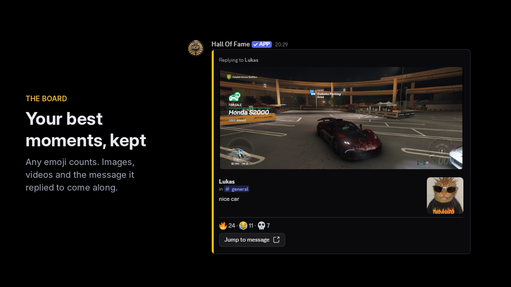
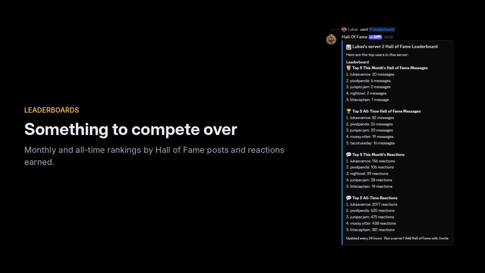
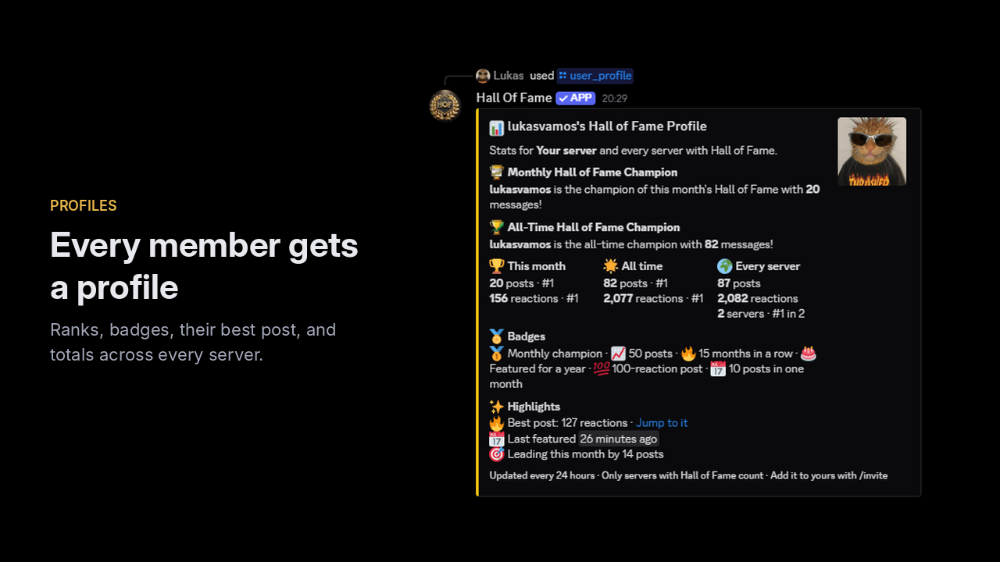

# App Directory listing

Copy for the Hall of Fame page in the Discord App Directory. Paste each block into the matching field in
the Developer Portal. Keep this file in step with the README when commands or defaults change.

Last checked against the bot: 3.0.0.

<br>


## Summary

Developer Portal > App Directory > Summary. Shown in directory search results. Limit 200 characters.

```
Turn your server's best messages into a Hall of Fame. Any emoji can feature a message, members compete on leaderboards and a yearly Wrapped, and no message text is ever stored.
```

<br>


## Description

Developer Portal > General Information > Description. Shown on the bot's profile when someone clicks
it in a server. Limit 400 characters. Kept to links only, as it is live.

```
💬 Join the support server: https://discord.gg/r98WC5GHcn

➕ Invite the bot: https://discord.com/oauth2/authorize?client_id=1177041673352663070

💻 Contribute to the bot: https://github.com/LukasKristensen/discord-hall-of-fame-bot

🔒 No message text stored. Privacy policy: https://github.com/LukasKristensen/discord-hall-of-fame-bot/blob/main/PRIVACY.md
```

<br>


## Detailed description

Developer Portal > App Directory > Detailed description. Shown on the app's directory page. Supports
markdown.

```
**Your server's best moments, and the members behind them.**

When a message gets enough reactions, Hall of Fame reposts it to your hall of fame channel. The members who land there get leaderboards, profiles and a yearly Wrapped, so your server has something to compete over.

**The board**

- Any emoji counts, custom server emojis included. Or choose a whitelist of up to 100.
- Images, videos and stickers are carried over, and videos stay playable.
- If the message was a reply, the message it replied to is shown with it, so the joke still makes sense.
- Reaction counts update live. A post that drops below the threshold is hidden until it climbs back.

**The recognition**

- /leaderboard ranks the server by posts and reactions earned.
- /user_profile shows a member's month, all time and every-server totals, their best post and the gap to the next rank.
- Badges for milestones: monthly champion, 10 to 500 posts, months in a row, a 100-reaction post and more.
- /hof_wrapped and /server_hof_wrapped give each member, and the server, a year in review.

**Count it your way**

- Most reactions on one emoji, total reactions, or unique people who reacted.
- Choose whether authors' own reactions count, how old a message can be, and whether only images and videos qualify.

**Your data, your call**

- No message text is stored. The bot keeps IDs, reaction counts and statistics, and the repost lives in your own channel on Discord.
- /my_data shows a member what is stored about them, privately, with buttons to download it, hide their totals across servers, stop the bot featuring their messages, or delete it, which removes them from every leaderboard, profile and Wrapped.
- Totals across servers never name a server.
- Removing the bot deletes your server's settings, posts and statistics. The privacy policy and the source code are public.

**Getting started**

1. Add the app and accept the permissions it asks for.
2. It creates a #hall-of-fame channel and picks a starting threshold from your member count.
3. Press Troubleshoot on the welcome message, or run /troubleshoot, to see whether the bot can read your channels and post to the board.
4. React as normal. Change the threshold with /set_reaction_threshold, or use an existing channel with /set_hall_of_fame_channel.

**Looking for a starboard?**

A starboard archives messages that collected enough stars. Hall of Fame is about recognition: any emoji can feature a message, and the members behind them get ranked for it. If a plain star archive is all you need, a starboard bot will do the job.

Free to use, with nothing held back behind voting. Questions or ideas? Join the support server or use /feedback.
```

<br>


## Tags

Up to 5. Picked for what people type when they look for this kind of bot. `starboard` is there because
many people search for one; the listing itself only ever compares against it, never calls the bot one.

```
hall of fame
starboard
leaderboard
reactions
highlights
```

<br>


## Category

Use as many categories as fit, since each one is another place the app can be browsed. Make **Social**
the first, add **Entertainment** if the portal offers it, and keep **Moderation and Tools**. Social
describes what the bot is for. In Moderation and Tools it is shown beside MEE6 and Dyno, which is a
crowded place to be found but still costs nothing to keep.

<br>


## Images

Upload in this order. The first image is the one most people see.

| Order | What it shows | File |
|:---|:---|:---|
| 1 | The video: a message gets reactions and appears on the board | [YouTube](https://www.youtube.com/watch?v=D4onxYa7Ikw) |
| 2 | A hall of fame post with an image and a reply, in the present layout | `Assets/listing_1_board_post.png` |
| 3 | `/leaderboard` | `Assets/listing_2_leaderboard.png` |
| 4 | `/user_profile` with badges and totals across servers | `Assets/listing_3_user_profile.png` |
| 5 | The three counting methods side by side | `Assets/reaction_calculation_methods_wide.jpg` |
| 6 | `/hof_wrapped` | Not made yet. Add it after the December Wrapped run |

Remove the old screenshots that show the "has surpassed 7 reactions" layout.

<p>
  
  
  
</p>

How they are made, so they can be redone the same way when the layout changes:

- Screenshots of the dev bot in a test server, with its header (name, avatar, verified APP badge) replaced
  by the live bot's, since the dev bot has its own name and a default avatar.
- The profile and leaderboard use example history: posts added to the development database only, and
  example names for members who have no Discord account. Nothing from a real server or member is shown
  apart from the developer's own account.
- Each one is placed on a 1280×720 black canvas with a short caption on the left (Inter, the landing
  page's gold `#e8b84a` for the label), so the carousel shows them all at the same size.

Still to redo: the leaderboard, since the test server's old name "Lukas's server 2" shows in its
title (the server is now called "Your server"), and the board post, which should have more than one
reaction.

<br>


## Links

| Field | Link |
|:---|:---|
| Support server | https://discord.gg/r98WC5GHcn |
| GitHub | https://github.com/LukasKristensen/discord-hall-of-fame-bot |
| Vote | https://top.gg/bot/1177041673352663070/vote |

Developer Portal > General Information also has a Privacy Policy URL and a Terms of Service URL. They
still point to the old gists. Once `PRIVACY.md` and `TERMS.md` are on `main`, set them to:

| Field | Link |
|:---|:---|
| Privacy Policy URL | https://github.com/LukasKristensen/discord-hall-of-fame-bot/blob/main/PRIVACY.md |
| Terms of Service URL | https://github.com/LukasKristensen/discord-hall-of-fame-bot/blob/main/TERMS.md |

The same goes for the privacy link in the Description above: the `main` link only works after the merge.

<br>


## Install permissions

Developer Portal > Installation > Default Install Settings, guild install, scopes `bot` and
`applications.commands`.

Match the invite link, `INVITE_PERMISSIONS` in `src/translations/messages.py` (`275146730576`):

| Permission | Why the bot needs it |
|:---|:---|
| View Channels | See the messages being reacted to |
| Read Message History | Fetch older messages when reactions arrive |
| Send Messages | Post to the hall of fame channel |
| Send Messages in Threads | Answer a ping inside a thread |
| Embed Links | Hall of fame posts, leaderboards and profiles are embeds |
| Use External Emojis | The leaderboard's month and all time emojis |
| Manage Channels | Create the #hall-of-fame channel on join |
| Manage Roles | Set the hall of fame channel's permission overwrites on join |
| Manage Messages | Remove chat from the hall of fame channel when chat there is off |
| Attach Files | The picture of the three counting methods in `/calculation_method`'s answer |
| Add Reactions | Not used yet, asked for ahead of later features |

The current listing also asks for Manage Threads, Create Public Threads and Pin Messages. Nothing in
`src/` uses them, so untick them. Servers that already have the bot keep the permissions they granted.

<br>


## Popular commands

The directory lists a handful of commands with their descriptions. If the portal lets you choose them,
show the ones members use: `/leaderboard`, `/user_profile`, `/hof_wrapped`, `/troubleshoot` and
`/set_reaction_threshold`.
