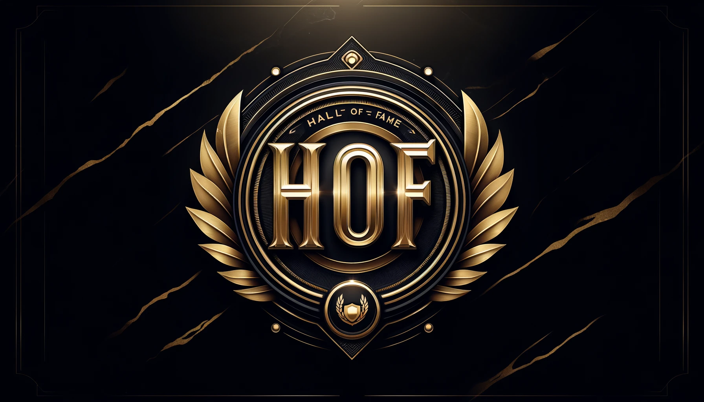
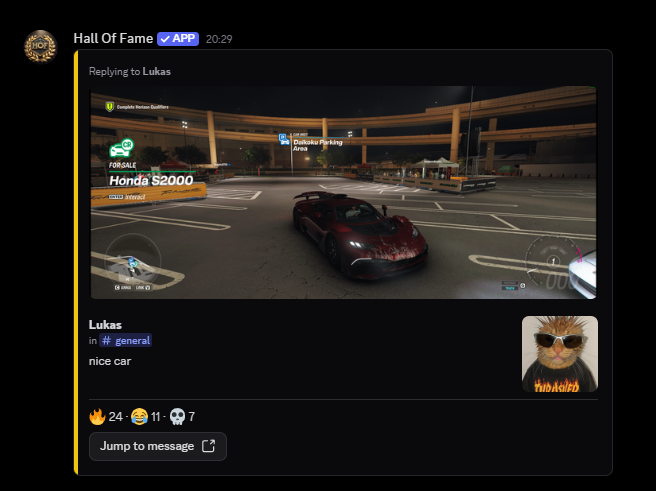
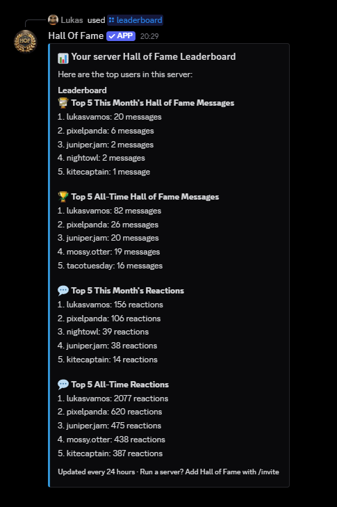
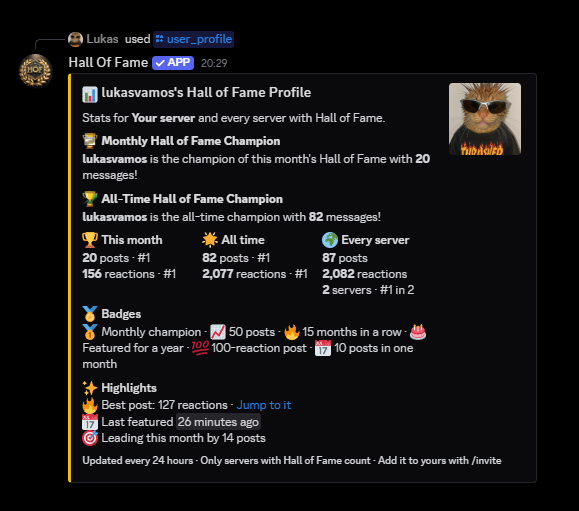
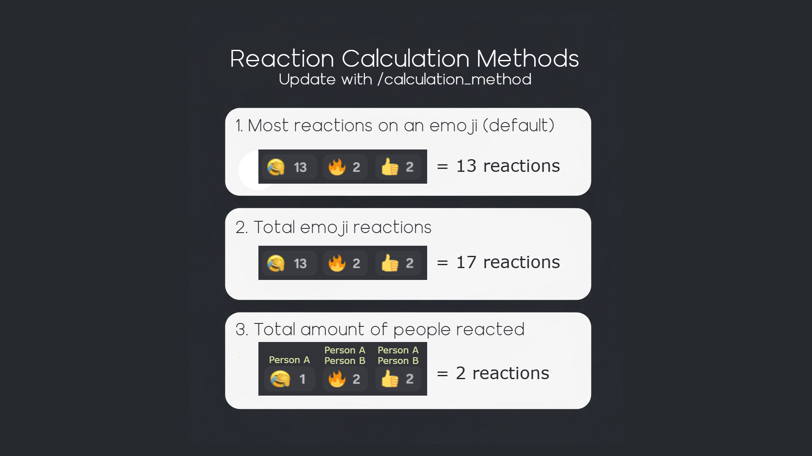

# Hall of Fame - Celebrate Your Discord Server's Best Moments

**Hall of Fame turns your server's best moments into a permanent highlight reel, and gives the credit
to the members who created them.** Any emoji your community actually reacts with can send a message to
the hall of fame, and the members who land there get leaderboards, profiles and a yearly wrapped for it.

It is a recognition bot, not an archive. The board is where the moments live; the leaderboards, member
profiles and Hall of Fame Wrapped are what make landing on it worth something.

It never stores your messages' text: only IDs, reaction counts and statistics. Every member can see,
download or delete what is kept about them with `/my_data`, as the [Privacy Policy](PRIVACY.md) explains.

[Add the bot to your server](https://discord.com/oauth2/authorize?client_id=1177041673352663070&permissions=275146730576&integration_type=0&scope=bot+applications.commands) ·
[Join the support server](https://discord.gg/r98WC5GHcn) ·
[Vote on top.gg](https://top.gg/bot/1177041673352663070/vote) ·
[What's new](CHANGELOG.md)

 

## Contents

- [What Hall of Fame does](#what-hall-of-fame-does)
- [How it differs from a starboard](#how-it-differs-from-a-starboard)
- [Quick start](#quick-start)
- [Commands](#commands)
- [How reactions are counted](#how-reactions-are-counted)
- [Frequently asked questions](#frequently-asked-questions)
- [Contributing](#contributing)
- [License](#license)
- [Privacy and terms](#privacy-and-terms)
- [Changelog](#changelog)

 

## What Hall of Fame does

**The board.** When a message gets enough reactions, it is reposted to your hall of fame channel with its
images, videos and the message it replied to, so the moment still makes sense months later. Any emoji
counts, and you choose how reactions are counted and how many are needed.

**The recognition.** Every post is credited to its author. `/leaderboard` ranks the server,
`/user_profile` shows a member's standing and badges, and `/hof_wrapped` gives each member their year in
review.

  
  

 

## How it differs from a starboard

A starboard copies messages that got enough stars to a channel. Hall of Fame does that with any emoji,
and adds the recognition on top.

| | Hall of Fame | A starboard |
|:---|:---|:---|
| Which emoji counts | Every emoji, or a whitelist you pick | One star emoji |
| Counting | Top emoji, total reactions, or unique people | A single fixed count |
| Media and replies | Images, videos and the replied-to message come along | Often links only, reply dropped |
| Credit | Leaderboards, profiles, badges and a yearly Wrapped | None |

 

## Quick start

1. [Invite the bot](https://discord.com/oauth2/authorize?client_id=1177041673352663070&permissions=275146730576&integration_type=0&scope=bot+applications.commands) and accept the permissions it asks for. Granting them
   later does not work, so accept them up front.
2. It creates a `#hall-of-fame` channel and picks a starting reaction threshold from your member count.
3. React to messages as normal. Anything that passes the threshold is reposted.
4. Change the threshold, the channel and every other setting with `/config` and its **Change settings**
   button.

Nothing showing up? The bot can only see channels it has access to, so if most channels are behind a
role, give the bot that role. `/troubleshoot` checks this and everything else that can stop a post.

 

## Commands

Settings commands need the **Manage Server** permission, and Discord only shows them to members who have
it. Everything else is open to every member. **Why isn't this on the board?** is under Apps when you
right-click or long-press a message. Add the bot to your own account (the **Add to your account** button
under `/invite`) to use `/user_profile`, `/my_data`, `/help`, `/invite`, `/vote` and `/feedback` in DMs too.

### Settings

| Command | What it does |
|:---|:---|
| `/config` | Every setting for this server. **Change settings** opens one form for all of them, listed below. |
| `/set_hall_of_fame_channel` | The channel the bot posts to. It checks its own permissions there and tells you what is missing, and sets the bot up if it never was. |
| `/troubleshoot` | Checks everything that can stop messages reaching the board, such as permissions, channels the bot cannot read, the whitelist and the daily post limit, and says how to fix it. **Change settings** under the answer opens the form. |

What the settings form changes:

| Setting | What it does |
|:---|:---|
| Board channel | The channel the bot posts to. |
| Reaction threshold | How many reactions a message needs, 1 to 1000. |
| Oldest message that can qualify | How old a message can be and still qualify, 1 to 3650 days. |
| How reactions are counted | See [How reactions are counted](#how-reactions-are-counted). |
| Count the author's own reaction | Whether reacting to your own message counts. |
| Only messages with an image or video | Only feature messages with an image or a video. |
| Hide posts that drop below the threshold | Hide a post if it drops back under the threshold, and bring it back if it climbs again. |
| Leave out messages from other bots | Whether messages from other bots can be featured. |
| Allow chat in the board channel | Off by default, so chat there is removed, which needs **Manage Messages**. |
| Count toward members' totals across servers | On by default, and the server is never named. |
| Only count whitelisted emojis | Count only the emojis on the whitelist, see below. |

The single-setting commands (`/set_reaction_threshold`, `/calculation_method`, `/set_post_due_date`,
`/include_authors_reaction`, `/require_image_or_video`, `/hide_hof_post_below_threshold`,
`/ignore_bot_messages`, `/allow_messages_in_hof_channel`, `/count_in_global_profiles`,
`/custom_emoji_check_logic`) and `/get_server_config` still work in this version, but are being retired in
favour of `/config`.

### Emoji whitelist

Every emoji counts until you tick **Only count whitelisted emojis** in the settings form. The whitelist
holds up to 100 emojis, and while it is empty every emoji still counts. Custom emojis are matched by ID, so
renaming one does not matter.

| Command | What it does |
|:---|:---|
| `/whitelist_emoji` / `/unwhitelist_emoji` | Add or remove one emoji. |
| `/clear_whitelist` | Empty the whitelist. |

### For everyone

| Command | What it does |
|:---|:---|
| `/leaderboard` | Ranks the server by posts and reactions, this month and all time. Updated daily. |
| `/user_profile` | A member's posts, reactions and ranks, their badges, best post and totals across every server with the bot. Defaults to you. |
| `/hof_wrapped` | Your year in review on one card, including your fame rate: one in how many of your messages reached the board. Anyone can open your **Year in squares** and **Top 10** from it, or press **Get my Wrapped** for their own. |
| `/server_hof_wrapped` | The year in review for the whole server. |
| **Why isn't this on the board?** | Says why a message is or is not on the board, for example too few reactions, too old, or a channel the bot cannot read. |
| `/my_data` | What the bot stores about you, with buttons to download it, hide your totals across servers, stop being featured, or delete it. Deleting keeps your posts on the boards but no longer credits them to you. |
| `/config` | Every setting for this server. Anyone can look; changing them needs Manage Server. |
| `/help` | Every command, grouped. |
| `/invite` | Add the bot to another server or to your own account. |
| `/vote` | Vote for the bot on top.gg. |
| `/feedback` | Send a bug report, an idea or a question to the developer. |

Replies about your own data, errors and checks like `/troubleshoot` are only shown to you.

 

## How reactions are counted

| Method | What it counts | Good for |
|:---|:---|:---|
| `most_reactions_on_emoji` (default) | The highest count on any single emoji | One reaction carrying a message |
| `total_reactions` | Every reaction added together | Servers that react with many different emojis |
| `unique_users` | How many different people reacted | Stopping one person from pushing a message through |

 

## Frequently asked questions

### How many reactions does a message need?

Whatever you set in `/config`. When the bot joins it picks a starting value from your
member count, between 1 and 7. It is not recalculated as the server grows, so adjust it yourself.

### What does a post include?

Up to ten images and videos, which play in place, plus stickers, link previews and links to other files.
Spoilers stay covered, a reply quotes the message it answers, and forwards and polls show their content. The post lists the eight most used emojis with their counts, and mentions do not
ping anyone again. Counts update live, and a post that drops below the threshold is hidden until it climbs
back, unless **Hide posts that drop below the threshold** is off in `/config`. Posts made before version 3.0 keep their old layout.

### Why isn't a message on the board?

Right-click it and choose Apps > **Why isn't this on the board?**. It runs the same checks as a reaction
does and says which one stopped it, for example too few reactions, too old, or a channel the bot cannot
read. For problems with the whole server, such as missing permissions, use `/troubleshoot`.

### What about age-restricted channels and sensitive images?

Messages from an age-restricted channel, and media Discord flags as explicit, are only posted to an
age-restricted board. Media flagged as gore or self-harm is never posted. A post that breaks either rule
later is hidden, and comes back if the rule stops applying.

### Which channels does it watch?

Every channel it can read. Channels behind a role stay hidden from the bot unless it has that role.
`/troubleshoot` shows how many channels it reads and lists the ones it cannot.

### Why can't I see the settings commands?

Discord only shows them to members with **Manage Server**. `/config` is open to everyone, but only Manage
Server can press **Change settings**. A server can show them to other roles under
Server Settings > Integrations > Hall of Fame, but running one still needs Manage Server.

### Can I use it outside a server?

Add it to your account with the **Add to your account** button under `/invite`. In DMs you can then see
your own totals across servers with `/user_profile` and manage your data with `/my_data`. Leaderboards,
Wrapped and settings belong to a server.

### When does Wrapped come out?

Each December, for every server with a post on its board that year and every member credited with one.
Open it with `/hof_wrapped` and `/server_hof_wrapped`. A member who asked not to be
featured gets no Wrapped and is left out of everyone else's.

### Can posts show up on the web?

Only in Discoverable servers, where Discord can show public channels on the web. The admins choose which
channels under Server Settings > Web Presence, and `/troubleshoot` reminds them the board is one of them.
The bot itself sends nothing to the web.

### Is there a limit?

A server gets up to 100 new posts a day. A member's posts count toward their stats up to 10,000 across
every server, which keeps what `/my_data` has to hand over small. Posts past it still reach the board.

### Is it free?

Yes. There is no paid tier and nothing is held back behind voting.

 

## Contributing

Bug fixes, features, tests and documentation are welcome. [CONTRIBUTING.md](CONTRIBUTING.md) covers
setting up a development bot, the tests and opening a pull request.

 

## License

Hall of Fame is **source-available, not open source**. You may read the code and run a copy on a private
test server to develop contributions. You may not host your own copy of the bot or reuse the code
elsewhere without written permission. See [LICENSE](LICENSE), or [add the official bot](https://discord.com/oauth2/authorize?client_id=1177041673352663070&permissions=275146730576&integration_type=0&scope=bot+applications.commands).

 

## Privacy and terms

The bot stores IDs, reaction counts and statistics, not the text or images of your messages. Removing it
deletes that server's data, and any member can see, download or delete their own with `/my_data`. See the
[Privacy Policy](PRIVACY.md) and the [Terms of Service](TERMS.md).

 

## Changelog

What changed in each version is in [CHANGELOG.md](CHANGELOG.md).
