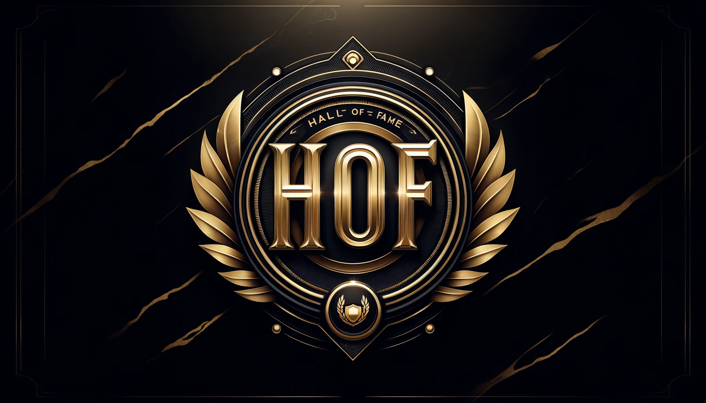
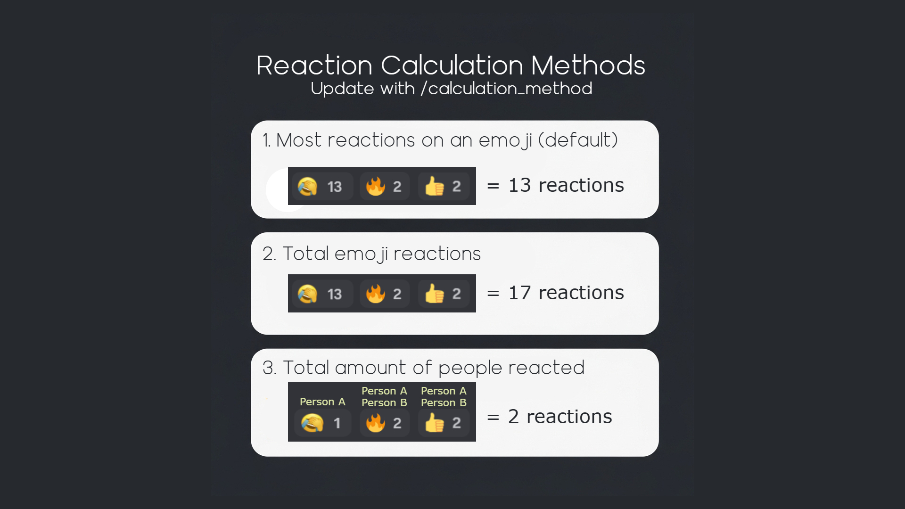

# Hall of Fame - Celebrate Your Discord Server's Best Moments

**Hall of Fame turns your server's best moments into a permanent highlight reel, and gives the credit
to the members who created them.** Any emoji your community actually reacts with can send a message to
the hall of fame, and the members who land there get leaderboards, profiles and a yearly wrapped for it.

It is a recognition bot, not an archive. The board is where the moments live; the leaderboards, member
profiles and Hall of Fame Wrapped are what make landing on it worth something.

It never stores your messages' text: only IDs, reaction counts and statistics. Every member can see,
download or delete what is kept about them with `/my_data`, as the [Privacy Policy](PRIVACY.md) explains.

[Add the bot to your server](https://discord.com/oauth2/authorize?client_id=1177041673352663070&permissions=275146730576&integration_type=0&scope=bot+applications.commands) ·
[Join the support server](https://discord.gg/r98WC5GHcn) ·
[Vote on top.gg](https://top.gg/bot/1177041673352663070/vote) ·
[What's new](CHANGELOG.md)

 

## Contents

- [What Hall of Fame does](#what-hall-of-fame-does)
- [How it differs from a starboard](#how-it-differs-from-a-starboard)
- [Quick start](#quick-start)
- [Commands](#commands)
- [Custom Emoji Whitelist](#custom-emoji-whitelist)
- [How reactions are counted](#how-reactions-are-counted)
- [Recognition: leaderboards, profiles and Wrapped](#recognition-leaderboards-profiles-and-wrapped)
- [Frequently asked questions](#frequently-asked-questions)
- [Contributing](#contributing)
- [License](#license)
- [Privacy and terms](#privacy-and-terms)
- [Changelog](#changelog)

 

## What Hall of Fame does

**The board.** The bot watches every channel it can read. When a message picks up enough reactions, it
is reposted to your hall of fame channel with its images, videos and the message it was replying to, so
the moment still makes sense months later. Any emoji counts, and you choose how reactions are counted
and how many are needed.

**The recognition.** Every featured message is credited to its author. `/leaderboard` ranks the server,
`/user_profile` shows a member's all time and monthly standing, and `/hof_wrapped` gives each member
their year in review. That is the half a plain message archive does not have.

 

## How it differs from a starboard

Hall of Fame is often found by people searching for a starboard, so it is worth being precise about the
difference. A starboard is an archive: react with a star, and once enough people do, the message is
copied to a channel. That is the whole feature.

| | Hall of Fame | A starboard |
|:---|:---|:---|
| The point | Recognising your members and their best moments | Archiving messages that passed a threshold |
| Which emoji counts | Every emoji, or a whitelist you pick | The one star emoji it was configured with |
| Counting | Top emoji, total reactions, or unique people | A single fixed count |
| Media | Images and videos are reposted with the message | Frequently links only |
| Reply context | The message being replied to is included | Usually dropped |
| Credit | Leaderboards, member profiles, monthly and all time ranks | None |
| Year in review | Hall of Fame Wrapped, per member and per server | None |
| Threshold | Starting value picked from your member count, then yours to set | Fixed default you tune yourself |

If all you want is a star archive, a starboard bot will do. If you want your server to compete over who
gets immortalised, that is what this is for.

 

## Quick start

1. [Invite the bot](https://discord.com/oauth2/authorize?client_id=1177041673352663070&permissions=275146730576&integration_type=0&scope=bot+applications.commands) and accept the
   permissions it asks for. Granting them afterwards does not work, so accept them up front.
2. The bot creates a `#hall-of-fame` channel, and picks a starting reaction threshold once from your
   member count so the board works before you configure anything.
3. React to messages as normal. Anything that passes the threshold is reposted automatically.
4. Tune it with `/set_reaction_threshold`, or point it at an existing channel with
   `/set_hall_of_fame_channel`.

If most of your channels are hidden behind a role, give the bot that role, otherwise it cannot see the
messages being reacted to. The bot checks this when it joins and posts what to fix on the board, and
`/troubleshoot` (or the **Troubleshoot** button on the welcome message and under `/get_server_config`) runs the same check any time.

 

## Commands

All commands are slash commands, apart from **Why isn't this on the board?**, which is under Apps when you right-click or long-press a message. They work inside a server with the bot. Add Hall of Fame to your own
account (the **Add to your account** button under `/invite`) and `/user_profile`, `/my_data` under
[Your data](#your-data), `/help`, `/invite`, `/vote` and `/feedback` also work in DMs and in servers
without the bot; see [Can I use it outside a server?](#can-i-use-it-outside-a-server). The rest need the
server's configuration, so they stay in servers that added the bot. The configuration ones need the **Manage Server**
permission and say so on each group. Discord only shows them in the command picker to members who have it, see
[Why can't I see the settings commands?](#why-cant-i-see-the-settings-commands). Everything under
[Recognition](#recognition-commands), [Your data](#your-data) and [Bot and help](#bot-and-help) is open to every
member. If a command is refused, for example because a value is out of range, only you see the reply.

### Setting up the board

Requires **Manage Server**.

| Command | Parameters | What it does |
|:---|:---|:---|
| `/set_hall_of_fame_channel` | `channel` | Point the bot at the channel it should post to. Checks its own permissions first (View Channel, Send Messages, Read Message History and Embed Links) and tells you what is missing. |
| `/set_reaction_threshold` | `reaction_threshold` (1 to 1000) | How many reactions a message needs. Seeded once on join from your member count, and fixed at that value until you change it here. |
| `/allow_messages_in_hof_channel` | `allow` (true/false) | Let members chat in the hall of fame channel. Off by default, so the board stays clean: chat is removed, and `/user_profile`, `/leaderboard` and the Wrapped commands are turned away there with a private note to use another channel. Removing chat needs the bot to have **Manage Messages** in that channel. |
| `/troubleshoot` | | A health check for debugging a board that is not posting. Checks everything that can stop messages reaching the board: the board's permissions, how many channels the bot can read and which ones members see but the bot does not (with the role that would open them), an empty emoji whitelist, a threshold above the member count, the daily post limit and when the last post was. Only you see the answer. |
| `/count_in_global_profiles` | `count` (true/false) | Whether members' totals across servers include their posts from this server. On by default. The server is never named either way. |

### Choosing what qualifies

Requires **Manage Server**.

| Command | Parameters | What it does |
|:---|:---|:---|
| `/calculation_method` | `most_reactions_on_emoji`, `total_reactions` or `unique_users` | How reactions are counted. The answer shows a picture of the three methods counting the same reactions. See [How reactions are counted](#how-reactions-are-counted). |
| `/include_authors_reaction` | `include` (true/false) | Whether reacting to your own message counts toward the threshold. |
| `/set_post_due_date` | `post_due_date` (1 to 3650 days) | How old a message can be and still qualify. |
| `/require_image_or_video` | `require` (true/false) | Only feature messages that contain an image or a video. |
| `/hide_hof_post_below_threshold` | `hide` (true/false) | Hide a post again if it drops back under the threshold, and restore it if it climbs back. |
| `/ignore_bot_messages` | `should_ignore_bot_messages` (true/false) | Whether messages from other bots can be featured. |

### Emoji whitelist

Requires **Manage Server**. Every emoji counts until you turn this on, see
[Custom Emoji Whitelist](#custom-emoji-whitelist).

| Command | Parameters | What it does |
|:---|:---|:---|
| `/custom_emoji_check_logic` | `All emojis` or `Only whitelisted emojis` | Switch whitelist mode on or off. |
| `/whitelist_emoji` | `emoji` | Add one emoji to the whitelist, up to 100. |
| `/unwhitelist_emoji` | `emoji` | Remove one emoji from the whitelist. |
| `/clear_whitelist` | | Empty the whitelist. |

### Recognition commands

Open to everyone.

| Command | Parameters | What it does |
|:---|:---|:---|
| `/leaderboard` | | Rank the server by hall of fame posts and reactions earned. Refreshed daily. |
| `/user_profile` | `specific_user` (optional) | All time and monthly totals and ranks for a member. Defaults to you. When the member has been featured in other servers too, the card ends with their posts, reactions and titles added up across every server with the bot, without naming any server. Earned badges, such as monthly champion or a 100-reaction post, sit under the columns; badges that come from other servers are left out when the member hid their totals. Used in a DM or a server without the bot, it only looks you up, and shows your totals across servers alone. |
| `/hof_wrapped` | | Your personal Hall of Fame Wrapped for the year. |
| `/server_hof_wrapped` | | The Hall of Fame Wrapped for the whole server. |
| **Why isn't this on the board?** | Right-click or long-press a message, then Apps | Says why that message is or is not on the board: already posted (with a link), hidden after dropping below the threshold, how many reactions it has against the threshold and how the server counts them, too old, from a bot, missing an image or video, in a channel the bot cannot read, the board missing or the bot unable to post there, or the daily post limit. Only you see the answer. |

### Your data

Open to everyone, answered only to you, and usable in DMs as well as servers.

| Command | Parameters | What it does |
|:---|:---|:---|
| `/my_data` | | What the bot stores about you, privately, with buttons to manage it. **Download my data** sends a file with every row (once a day). **Hide my totals across servers** leaves them off your profile, which then shows only the server it is looked up in. **Stop featuring me** stops the bot reposting or storing new messages of yours, keeping only your user ID and the date to remember it, and a reply to one of your messages is reposted without your message; **Feature me again** undoes it. **Delete my data** removes everything stored about you after you confirm, including a choice not to be featured; your posts stay on the boards but are no longer credited to you, and the done message offers **Stop featuring me** again. |

### Bot and help

Open to everyone.

| Command | Parameters | What it does |
|:---|:---|:---|
| `/help` | | List every command, grouped by what it changes. Mentioning the bot on its own shows the same overview. |
| `/get_server_config` | | Show every setting for this server, with the command that changes it, and a **Troubleshoot** button for when something is not working. |
| `/invite` | | Buttons for adding the bot to another server or to your own account. |
| `/vote` | | A button for voting for the bot on top.gg. |
| `/feedback` | `topic` (Bug report, Idea or feature request, Question or Something else) | Send a bug report, an idea or a question to the developer through a short form that asks for what helps with the topic. Only you see the thank-you. Up to three a day. |

 

## Custom Emoji Whitelist

By default every emoji counts toward the threshold, including custom server emojis. Turning on the
whitelist narrows that down to a set you choose, which is how you run a board driven by one specific
reaction, a small set of in-joke emojis, or a classic star only board.

Enable it with `/custom_emoji_check_logic`, then manage the list with `/whitelist_emoji`,
`/unwhitelist_emoji` and `/clear_whitelist`. `/get_server_config` shows the current whitelist.

The whitelist holds up to 100 emojis. While it is empty every emoji still counts. Custom emojis are
matched by ID, so renaming one does not stop it counting.

 

## How reactions are counted

Different servers mean different things by "popular", so `/calculation_method` picks between three ways
of counting a message:

| Method | What it counts | Good for |
|:---|:---|:---|
| `most_reactions_on_emoji` (default) | The highest count on any single emoji | Servers where one reaction should carry a message |
| `total_reactions` | Every reaction on the message added together | Servers that react with many different emojis |
| `unique_users` | How many different people reacted, counted once each | Stopping one person from pushing a message through |

`/calculation_method` answers with this picture too, whether the method changed or was already set. It is
attached when the bot may attach files in that channel, shown from GitHub when it may only embed links,
and left out when it may do neither.

`/include_authors_reaction` decides whether the author reacting to their own message counts, and
`/hide_hof_post_below_threshold` hides a post again if reactions are later removed.

 

## Recognition: leaderboards, profiles and Wrapped

Getting featured is meant to be worth something, so the bot keeps score.

- **`/leaderboard`** ranks the server by hall of fame posts and by reactions earned, refreshed daily.
- **`/user_profile`** shows one member's monthly, all time and across-server totals, where they sit in
  the server for each, their best post, when they were last featured, how far they are from the next
  rank and the badges they have earned, such as monthly champion or 100 posts. Call it on someone else
  to compare.
- **`/hof_wrapped`** gives a member their year in review, and **`/server_hof_wrapped`** does the same
  for the whole server.

A member's posts count toward all of this up to 10,000 across every server. The limit keeps what the
bot stores about any one member small enough that `/my_data` can always give them all of it. Posts past
it still reach the board but are not credited. Reaching it takes a server's whole daily limit of 100
posts, every day for 100 days, all by one member.

 

## Frequently asked questions

### Does it only work with the star emoji?

No, and that is the main difference from a starboard. Every emoji counts by default, custom server
emojis included. If you want only specific ones to count, turn on `/custom_emoji_check_logic` and add
them with `/whitelist_emoji`.

### How many reactions does a message need?

Whatever you set with `/set_reaction_threshold`, from 1 to 1000. So that the board works before anyone configures it,
the bot picks a starting value from your member count when it joins, between 1 for a tiny server and 7
for a large one. That happens once, on join. It is not recalculated as the server grows, so revisit it
yourself if your membership changes a lot.

### Does it repost images and videos?

Yes. Images, videos and stickers are carried over into the hall of fame post, and videos are posted so
that they stay playable rather than becoming a bare link.

### What happens when someone removes their reaction?

The post updates its reaction count live. If it drops back below the threshold it is hidden, and it
reappears if the message climbs back over the line. Turn that off with
`/hide_hof_post_below_threshold`.

### Does it keep the conversation context?

Yes. If the featured message was a reply, the message it replied to is shown alongside it, so a
punchline still makes sense out of context.

### Can I see who gets featured most?

Yes, that is the point of it. `/leaderboard` ranks the server, `/user_profile` shows a member's all time
and monthly standing, and `/hof_wrapped` gives them a year in review.

### Can I limit it to only images and videos?

Yes, with `/require_image_or_video`, which suits servers where the board is meant to be a gallery rather
than a quote wall.

### Can I use it outside a server?

Yes, once you add it to your account with the **Add to your account** button under `/invite`. In DMs
and in servers without Hall of Fame you can look up your own profile with `/user_profile`, which then
shows your posts and reactions added up across every server with the bot. Other members can only be
looked up inside a server with the bot. You can also see, download or delete your data with
`/my_data`. Leaderboards, Wrapped and settings belong to a server, so
they only work in servers that added the bot.

### Is the bot free?

Yes. There is no paid tier and no feature held back behind voting. The source code is public for
anyone to read and contribute to, see [License](#license).

### Which channels does it watch?

Every channel it has permission to read. Channels restricted to a role stay invisible to the bot unless
it is given that role. `/troubleshoot` shows how many channels it reads, lists the ones members can see
but the bot cannot, and names the role that would open most of them. Staff-only channels are counted
apart, since leaving the bot out of those is usually on purpose.

### Why can't I see the settings commands?

Discord only shows them to members with the **Manage Server** permission, since everyone else would be
refused. A server can show them to other roles under Server Settings > Integrations > Hall of Fame, but
running one still needs Manage Server.

 

## Contributing

Bug fixes, features, tests and documentation are all welcome. [CONTRIBUTING.md](CONTRIBUTING.md) covers
setting up a development bot, the test suites and opening a pull request.

 

## License

Hall of Fame is **source-available, not open source**. The code is public so that anyone can see exactly
what the bot does with their server's messages, and so that anyone can contribute.

- You may read the code, and fork and run it on a private test server to develop contributions.
- You may not host or operate your own copy of the bot, or reuse the code elsewhere, without written
  permission.

See [LICENSE](LICENSE) for the full terms. To use the bot, [add the official
one](https://discord.com/oauth2/authorize?client_id=1177041673352663070&permissions=275146730576&integration_type=0&scope=bot+applications.commands) to your server.

 

## Privacy and terms

The bot stores IDs, reaction counts and statistics, not the text or images of your messages. Removing it
from a server deletes that server's data, and any member can see, download or delete their own with
`/my_data`. The [Privacy Policy](PRIVACY.md) lists exactly what is kept, and the
[Terms of Service](TERMS.md) cover using the bot.

 

## Changelog

What changed in each version is in [CHANGELOG.md](CHANGELOG.md).
